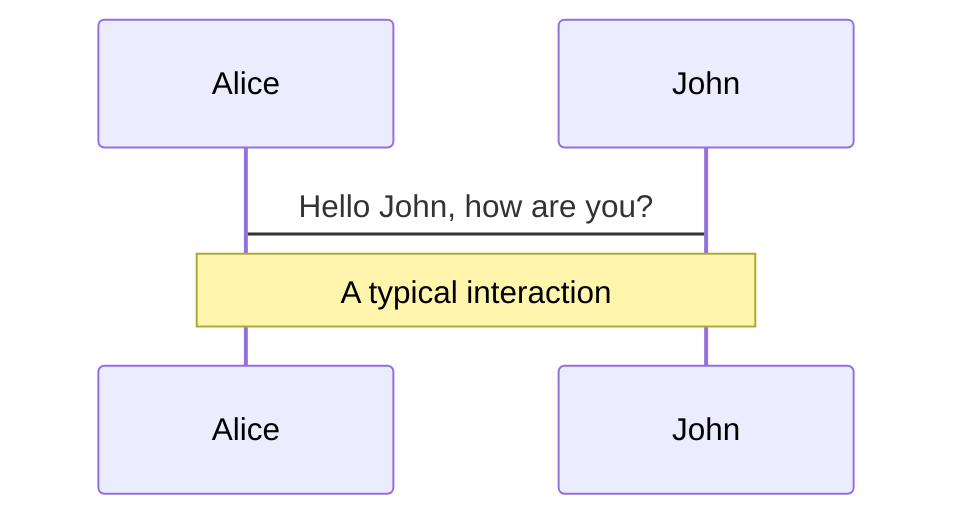
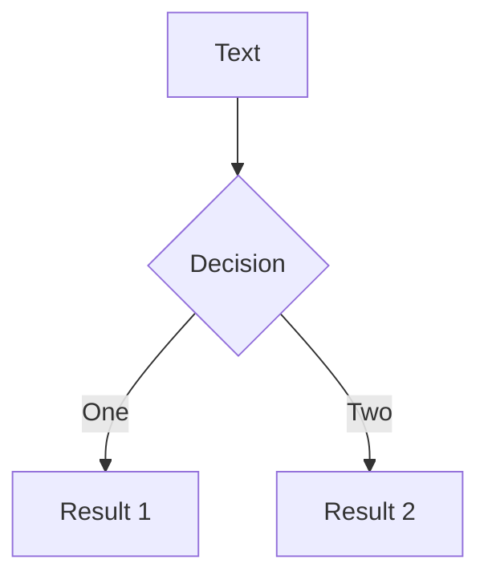

<!-- Official upstream snapshot (MIT; see ../../THIRD_PARTY_NOTICES.md). Retrieved 2026-11-14. -->
# Deckcraft guide: mermaid

- **Category:** Visuals
- **Curated practice:** Simplify graphs before styling them; check light/dark contrast, label sizes, export rendering, and a textual explanation.
- **Deep-dive workflow:** [visuals.md](../visuals.md)
- **Canonical documentation:** https://sli.dev/features/mermaid.html
- **Local siblings:** [feature atlas](../INDEX.md)

The preserved upstream reference below is labeled for the documentation version in
`coverage.json`; verify features and defaults against your installed Slidev version.
Do not copy the upstream YAML document frontmatter into a slide.

---

---
url: /features/mermaid.md
description: |
  Create diagrams/graphs from textual descriptions, powered by Mermaid.
---

# Mermaid Diagrams

You can also create diagrams/graphs from textual descriptions in your Markdown, powered by [Mermaid](https://mermaid.js.org/).

Code blocks marked as `mermaid` will be converted to diagrams, for example:

````md

````

You can further pass an options object to it to specify the scaling and theming. The syntax of the object is a JavaScript object literal, you will need to add quotes (`'`) for strings and use comma (`,`) between keys.

````md

````

Visit the [Mermaid Website](https://mermaid.js.org/) for more information.
