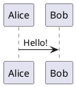

<!-- Official upstream snapshot (MIT; see ../../THIRD_PARTY_NOTICES.md). Retrieved 2026-11-14. -->
# Deckcraft guide: plantuml

- **Category:** Visuals
- **Curated practice:** Treat the default renderer as a network and privacy dependency; self-host or bundle a proven image for offline/critical talks.
- **Deep-dive workflow:** [visuals.md](../visuals.md)
- **Canonical documentation:** https://sli.dev/features/plantuml.html
- **Local siblings:** [feature atlas](../INDEX.md)

The preserved upstream reference below is labeled for the documentation version in
`coverage.json`; verify features and defaults against your installed Slidev version.
Do not copy the upstream YAML document frontmatter into a slide.

---

---
url: /features/plantuml.md
description: |
  Create diagrams from textual descriptions, powered by PlantUML.
---

# PlantUML Diagrams

You can create PlantUML diagrams easily in your slides, for example:

````md

````

The source code will be sent to https://www.plantuml.com/plantuml to render the diagram by default. You can also set up your own server by setting the `plantUmlServer` in the [Slidev configuration](https://sli.dev/custom/index#headmatter).

Visit the [PlantUML Website](https://plantuml.com/) for more information.
