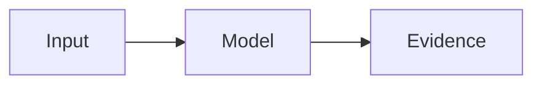
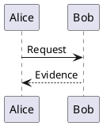

# Diagrams, math, images, and media

Primary sources: [Mermaid](features/mermaid.md), [PlantUML](features/plantuml.md), [LaTeX](features/latex.md), [built-in media components](components.md), [assets](features/bundle-remote-assets.md).

## Images and illustration

Use normal Markdown `` for local public assets, HTML `` for CSS/UnoCSS size/crop, or an `image*` layout for full/split treatment. Compress images and retain high-quality source. An empty alt is for purely decorative images. Background text needs an actual contrast scrim; light/dark diagrams may need `<LightOrDark>` variants. Give custom SVG a text alternative and unique IDs; avoid filters harming browser/export rendering.

`remoteAssets: true|'dev'|'build'` uses `vite-plugin-remote-assets` to cache/download remote assets during the selected phase. Remote sources may change/disappear; save allowed critical imagery locally when practical. PWA caches built assets, not arbitrary remote requests. See [hosting](hosting.md).

## Mermaid

````md

````

`setup/mermaid.ts` uses `defineMermaidSetup(() => ({ theme: 'base', themeVariables: { ... } }))` for global config; see [Mermaid config](https://sli.dev/custom/config-mermaid.html). [Mermaid renderer setup](https://sli.dev/custom/config-mermaid-renderer.html) can configure rendering behavior in the installed version. Both per-block object literal options and global theme need tested version syntax and legible scale. Use the fewest nodes/edges that explain the idea; do not shrink an architecture of 30 boxes into a diagram-slide-shaped paragraph. Explain diagram semantics in prose/notes. Inspect SVG icon/diagram export and editable-PPTX rasterization.

## PlantUML

````md

````

By default diagram source is sent to `https://www.plantuml.com/plantuml`; `plantUmlServer` changes this. That is a privacy, availability, and reproducibility dependency. Do not send confidential architecture/source to the public service. Use an authorized self-hosted renderer or generated local image for critical/offline delivery and inspect the resulting asset.

## KaTeX math

Use `$inline$` or `$$display$$`, with exact syntax from [LaTeX support](features/latex.md). Chemical formula support depends on the bundled KaTeX extension as documented there. Surround a formula with a statement of variables, units, and takeaway. A formula is not a self-explanatory proof. `setup/katex.ts` returns KaTeX options via `defineKatexSetup`, e.g. `maxExpand`; consult [KaTeX options](https://katex.org/docs/options.html) and [supported functions](https://katex.org/docs/supported). Avoid disabling safety options to force untrusted TeX. KaTeX may stay an image in editable PPTX; PDF visual inspection and font checks are still required.

## Video, embeds, and rich interaction

`<SlidevVideo>` supports local multiple codecs, click synchronization, `autoplay='once'`, `controls`, reset behavior, posters, and print timestamp. Provide playback controls, captions/transcript, meaningful poster, and audio check. `Youtube`, `Tweet`, `BlueSky`, and iframe layouts require network, third-party scripts, framing permissions, and often privacy consideration. Use local image fallback for a critical point. Do not record third-party/copyright media without appropriate rights.

## Charts and canvas/WebGL

Use Vue/SVG/canvas libraries only when the visual model benefits. Bundle/pin dependencies, handle `onSlideEnter`/`Leave`, and render static deterministic data before animation. Explain a chart comparison and source/date in text; direct-label where possible. Canvas/WebGL generally has no meaningful PowerPoint native shape and some effects are rasterized. Test final and intermediate screenshots, print output, pixel ratio, device support, and fallback. Animations must settle before auto-export; explicit `--wait` is appropriate for a known render time, not a substitute for waiting on actual application readiness.
